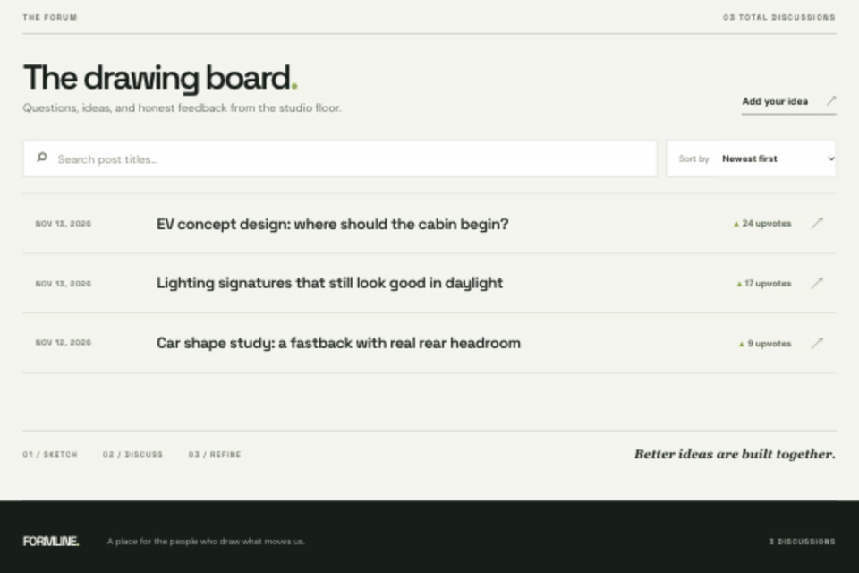

# Web Development Final Project — Formline HobbyHub

Submitted by: **Yudhiishbala V Senthilkumar**

**Formline** is a forum for people who love designing cars. Share a design question or concept, compare ideas in the comments, and give useful discussions an upvote.

## Required Features

The following required functionality is complete:

- [x] A create form requires a post title and accepts optional text and an external image URL.
- [x] The home feed lists posts with only their creation date, title, and upvote count. Text and images appear on the post page.
- [x] Each post opens at its own `/posts/:id` URL with its text, image, and comments.
- [x] Visitors can sort the feed by creation time or upvotes and search post titles.
- [x] Visitors can add comments below a post.
- [x] Each click of a post's upvote button adds one vote; repeat upvotes are allowed.
- [x] Authors can edit or delete their own posts from the post page.

## Stretch Features

- [x] A browser identity is created automatically and attached to new posts and comments. Only a post's original author sees its edit and delete controls.
- [x] A loading animation appears while the forum is fetched.
- [ ] Repost an earlier post as a linked thread.
- [ ] Let visitors customize the interface.
- [ ] Add video sharing, post flags and filters, or direct image uploads.

## Video Walkthrough

This GIF shows a real browser run: search the feed, create a post with text and an image URL, upvote and comment, edit, sort, then delete the post.



## Run Locally

```bash
npm ci
npm run dev
```

Open the URL printed by Vite. Without Supabase settings, Formline runs in **Browser Demo** mode. It starts with three car design discussions and saves new posts, comments, and votes in that browser's `localStorage`. This mode is useful for trying the complete interface, but its data is not shared across devices.

## Connect Supabase

1. Create a Supabase project and enable [anonymous sign-ins](https://supabase.com/docs/guides/auth/auth-anonymous) in **Authentication → Providers**.
2. Run [`supabase/migrations/20261113000000_create_hobbyhub.sql`](supabase/migrations/20261113000000_create_hobbyhub.sql) in the project's SQL Editor. It creates `posts`, `comments`, indexes, author permissions, and an atomic upvote function.
3. Copy `.env.example` to `.env` and add the project's URL and **publishable** key:

   ```env
   VITE_SUPABASE_URL=https://YOUR_PROJECT_REF.supabase.co
   VITE_SUPABASE_PUBLISHABLE_KEY=YOUR_PUBLISHABLE_KEY
   ```

4. Restart `npm run dev`. The status badge should read **SUPABASE LIVE**. Create a post in one browser and open it in another to check shared data. An incomplete configuration or connection error appears on screen with a retry button.

Never use a service-role or secret key in a `VITE_` variable. The cloud mode uses anonymous Supabase Auth and [row-level security](https://supabase.com/docs/guides/database/postgres/row-level-security) so only the author can change a post. Clearing browser storage can lose the anonymous account's ability to edit its earlier posts.

The migration and cloud adapter are ready, but this repository has **not yet been connected to a live Supabase project**. A live database check remains to be done after credentials are provided.

## Tests and Build

```bash
npm test
npm run build
```

Tests cover input rules, feed search and sorting, browser persistence, Supabase calls, and the main interface flows. For production hosting, configure a single-page-app fallback to `index.html` so direct post URLs work after refresh.

## Notes

The [three-minute Demo Day outline](docs/demo-day.md) follows the GIF's feature sequence. The linked Project 7 Crewmates app remains in its own repository; Formline is a separate final project.

## Submission Notes

- [x] Feature checklist and GIF walkthrough are included.
- [x] Work is committed in milestones.
- [x] Push this project to a **private** GitHub repository.
- [ ] Add `codepathreview` as a collaborator on that private repository.
- [ ] Submit the repository through the course portal.

The course portal submission is a separate step after the repository is ready.
